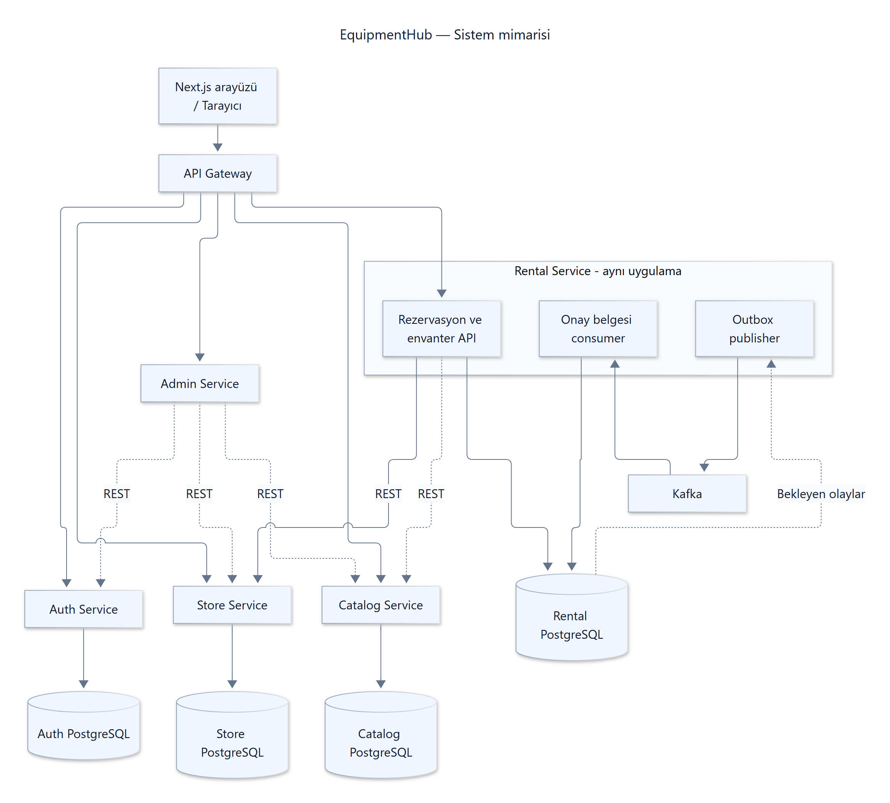
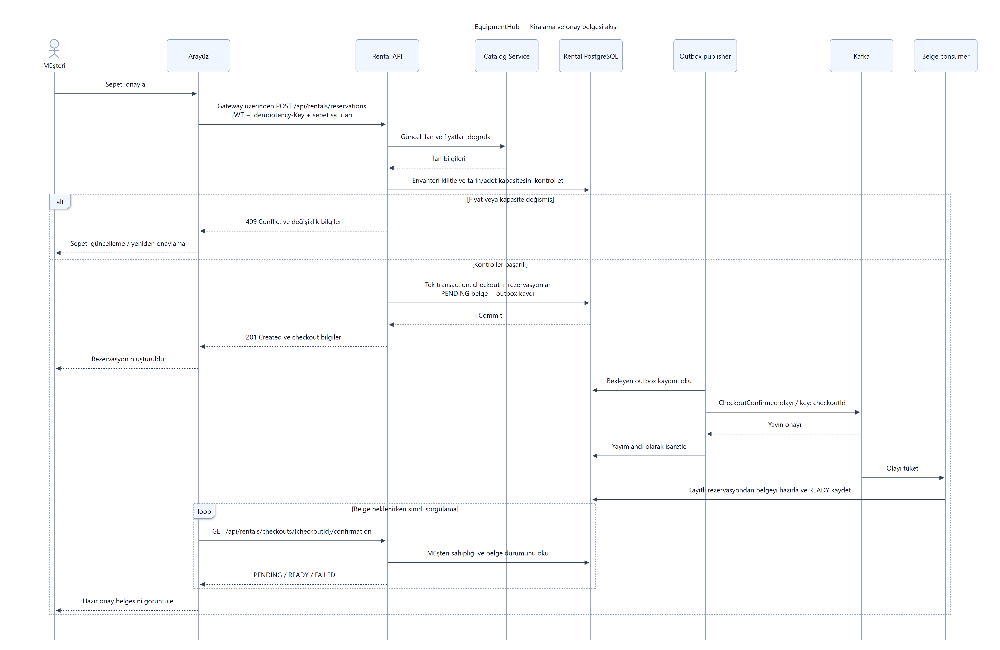
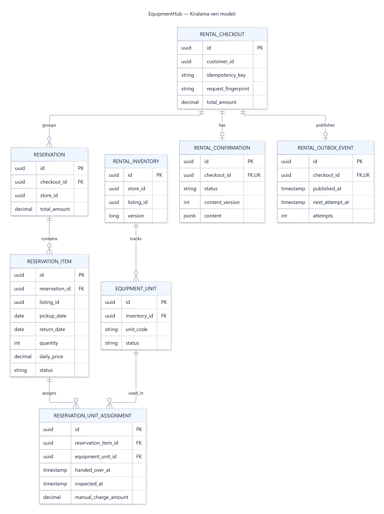

# EquipmentHub

EquipmentHub, müşterilerin mağaza seçerek ekipman kiralayabildiği bir full-stack
uygulamadır. Tarih ve adet seçimiyle başlayan süreç; çok mağazalı rezervasyon,
mağazadan teslim alma, geri teslim ve cihaz kontrolüne kadar takip edilir.
Mağaza sahipleri kendi katalog ve envanterlerini, platform yöneticisi ise
hesapları, mağaza başvurularını ve yayın durumlarını yönetir.

Proje; servis sınırları, kimlik doğrulama, eşzamanlı rezervasyonların tutarlılığı,
asenkron mesajlaşma ve CI konularını çalışan bir kiralama senaryosunda uygulamak
için geliştirilmiştir.

## Uygulamada neler var?

| Kullanıcı | İşlevler |
| --- | --- |
| Ziyaretçi | Ana sayfa, aktif mağazalar, mağaza vitrini ve ürün detaylarını görüntüleme |
| Müşteri | Kayıt/giriş, hesap bilgilerini düzenleme, uygunluk takvimi, adet seçimi, sepet, rezervasyon, iptal, geri teslim talebi ve onay belgesini görüntüleme |
| Mağaza sahibi | Mağaza profili, ürün ve fiyat yönetimi, fiziksel cihaz envanteri, rezervasyonlar, teslim alma/geri teslim kayıtları ve cihaz kontrolü |
| Platform yöneticisi | Mağaza başvurularını inceleme, hesap erişimini yönetme, mağaza ve ilan durumlarını düzenleme; liste ve detay ekranları |

Müşteri önce mağazayı, ardından o mağazanın ürünlerini keşfeder. Sepette farklı
mağazaların ürünleri birlikte bulunabilir. Aynı ürünün farklı tarih aralıkları
ayrı satırlar olarak korunur; her satırın adedi bağımsızdır.

## Teknolojiler

| Katman | Kullanılan araçlar |
| --- | --- |
| Backend | Java 25, Spring Boot 4.1.2, Spring Security, Spring Data JPA, Hibernate, Bean Validation, Lombok, Maven Wrapper |
| API girişi ve servis iletişimi | Spring Cloud Gateway, REST API, Spring RestClient |
| Veritabanı | PostgreSQL 18.6; Auth, Store, Catalog ve Rental için ayrı veritabanları |
| Mesajlaşma | Apache Kafka 4.4.0, Spring Kafka, transactional outbox |
| Frontend | Next.js 16.4.5 App Router, React 19, TypeScript, Tailwind CSS 4 |
| Formlar ve arayüz | TanStack Query, React Hook Form, Zod, Base UI, React DayPicker, Lucide, Sonner |
| Test ve CI | JUnit, Mockito, Maven Surefire, Jenkins Multibranch Pipeline |
| Yerel ortam | Docker Compose, Compose Watch, Node.js 24 |

## Sistem mimarisi

Tarayıcı API isteklerini Gateway üzerinden gönderir. Her iş servisi kendi
verisinin sahibidir; başka bir servisin veritabanına bağlanmaz. Admin Service
yönetim isteklerini ilgili servise iletir ve ayrı bir veritabanı tutmaz.



[Mermaid kaynağı](assets/diagrams/system-architecture.mmd)

Diyagram temel bağımlılıkları gösterir. Mağaza kaydındaki Auth → Store profil
oluşturma çağrısı gibi yardımcı servis çağrıları sadeleştirme amacıyla çizilmemiştir.
Kafka producer ve consumer aynı Rental uygulamasındadır; broker ayrı container'da
çalışır. Belge hazırlamak için ek bir mikroservis bulunmaz.

### Güvenlik ve veri sahipliği

- `CUSTOMER`, `STORE_OWNER` ve `PLATFORM_ADMIN` rolleri kullanılır. Admin rolü
  herkese açık kayıt formundan seçilemez.
- Access JWT ile kimlik doğrulanır; refresh oturumu HttpOnly cookie üzerinden
  yönetilir. Cookie kullanan Auth işlemlerinde CSRF koruması vardır.
- Gateway ve iş servisleri erişim kurallarını uygular. Mağaza sahibi işlemlerinde
  mağaza kimliği oturumdan çözülür; müşterinin rezervasyon ve belgelerinde sahiplik
  kontrol edilir.
- Frontend Proxy erken yönlendirmeyi, sayfa guard'ları oturum/rol deneyimini
  yönetir. API yetkilendirmesi backend'de uygulanır.
- Mağaza kaydı incelemeye alınır. Auth hesabı onaylanmadan mağaza yönetimine giriş
  yapılamaz; kayıt sırasında Store profilinin oluşturulması bu onayın yerine geçmez.

## Kiralama ve tutarlılık

Sepet tarayıcıda hesap bazında saklanır. Onay sırasında backend güncel mağaza/ilan
durumunu, fiyatı, tarih aralığını ve kapasiteyi yeniden kontrol eder. Arayüzde
gösterilen uygunluk, stok ayırma işleminin yerine geçmez.

Çok mağazalı sepet, Rental veritabanında tek transaction ile kaydedilir ve mağaza
bazında rezervasyonlara ayrılır. İlgili envanter kayıtları kilitlenerek eşzamanlı
isteklerin kapasiteyi aşması önlenir. Fiyat veya uygunluk değişmişse `409 Conflict`
döner; sepetin bir kısmı sessizce rezerve edilmez. `Idempotency-Key` aynı onay
isteğinin tekrarlanmasında ikinci bir checkout oluşturulmasını önler.

Kiralama tarihleri `Europe/Istanbul` saat diliminde ele alınır: teslim alma 12.00,
geri teslim 09.00'dur. Geri teslim tarihi kiralama gün hesabının dışındadır.
Müşteri teslim alma zamanından en az 24 saat önce iptal edebilir. Fiziksel cihaz
ataması, geri teslim kaydı ve cihaz kontrolü mağaza operasyonunda ayrıca izlenir.

### Checkout ve asenkron onay belgesi



[Mermaid kaynağı](assets/diagrams/rental-checkout-flow.mmd)

Belge üretimi rezervasyon yanıtını bekletmez. Checkout ile outbox kaydı aynı
transaction'da tutulduğu için, yayın geçici olarak başarısız olduğunda iş
veritabanında bekler ve yeniden denenir. Kafka kesintisi sonrasında yayın devam
edebilir; ilk Compose başlangıcı ise broker'ın sağlıklı olmasını bekler.

Ana topic `equipmenthub.rental.checkout-confirmed.v1`, mesaj anahtarı `checkoutId`'dir.
Teslimat **at-least-once** yaklaşımındadır: aynı olay yeniden gelebilir.
Consumer hazır belgeyi tekrar üretmez; checkout başına tek belge kısıtı ve
idempotent işleme çift kayıt oluşmasını önler. Kontrollü yeniden denemelerden
sonra işlenemeyen mesajlar `.dlt` topic'ine ayrılır.

Belgenin onaylanan ürün, tarih, adet ve tutar bilgileri JSONB içerik olarak
saklanır. Mağaza adı belge hazırlanırken alınır. Hazır belgeyi görüntülemek
yeniden üretim başlatmaz; sonraki iptal/teslim işlemleri kiralama ekranında
izlenir. Yapılandırma ve gözlemleme adımları: [Kafka rehberi](infra/kafka/README.md).

## Kiralama veri modeli

Aşağıdaki şema Rental veritabanının temel ilişkilerini gösterir; tüm kolonları
içermez. `customer_id`, `store_id` ve `listing_id` diğer servislere ait UUID
referanslarıdır. Veritabanları arasında foreign key veya doğrudan join yoktur.



[Mermaid kaynağı](assets/diagrams/rental-data-model.mmd)

İlan, kiralanabilecek ürünün katalog kaydıdır; `EQUIPMENT_UNIT` ise mağazadaki
tek bir fiziksel cihazı temsil eder. Rezervasyon kaleminde ürün adı ve kabul
edilen fiyat saklanır; sonradan katalogda yapılan düzenleme geçmiş tutarı değiştirmez.
Outbox kayıtları kalıcı işlem geçmişi olarak kullanılmaz; tamamlanan işler için
temizlik uygulanır, onay belgesi ayrı saklanır.

## Yerel kurulum

Docker Desktop veya Docker Engine ile güncel Docker Compose gerekir. Java,
Maven ve Node.js uygulama image'ları içinde bulunur; Compose ile çalıştırmak için
bunları host'a ayrıca kurmak gerekmez. Komutlar depo kökünde çalıştırılır.

### 1. Ortam ayarları

Yeni klonda `.env` yoksa PowerShell ile örnek dosyayı kopyalayın:

```powershell
if (-not (Test-Path .env)) { Copy-Item .env.example .env }
```

`.env` içinde şu değerleri yerel ortamınız için doldurun:

- Dört veritabanının `*_DB_PASSWORD` değerleri.
- Servisler arası profil oluşturma için `STORE_PROVISIONING_PASSWORD`.
- İlk yönetici hesabı için `PLATFORM_ADMIN_EMAIL` ve `PLATFORM_ADMIN_PASSWORD`.
- JWT imzalama için `AUTH_JWT_SECRET`: Base64 biçiminde en az 32 rastgele byte.

32 byte'lık JWT anahtarı üretmek için PowerShell:

```powershell
$jwtBytes = New-Object byte[] 32
$rng = [System.Security.Cryptography.RandomNumberGenerator]::Create()
$rng.GetBytes($jwtBytes)
[Convert]::ToBase64String($jwtBytes)
$rng.Dispose()
```

Üretilen değeri yalnız yerel `.env` dosyasına koyun. Container'lar arasındaki
`*_DB_URL` adreslerinde Compose servis adlarını koruyun. Yerel HTTP kullanımında
`AUTH_REFRESH_COOKIE_SECURE=false` kalır. `.env` Git dışında tutulur.
Jenkins kullanmayacaksanız `JENKINS_AGENT_SECRET` boş kalabilir.

### 2. Uygulamayı başlatma

```powershell
docker compose up -d --build
```

İlk çalıştırmada image indirme ve bağımlılıkların kurulması zaman alabilir.
Servisler başladıktan sonra varsayılan adresler:

| Bileşen | Adres |
| --- | --- |
| Web arayüzü | [localhost:3000](http://localhost:3000) |
| API Gateway | `http://localhost:8080` |
| Kafka host bağlantısı | `localhost:19092` |
| Auth PostgreSQL host bağlantısı | `localhost:5432` |

Portlar `.env` üzerinden değiştirilebilir; Kafka host portu Compose'ta tanımlıdır.
Frontend portunu değiştirirseniz `FRONTEND_ORIGIN` değerini de aynı adrese ayarlayın.
Diğer iş servisleri ve Store/Catalog/Rental veritabanları yalnız Compose ağındadır.
Gateway kök adresinin bir web sayfası sunması beklenmez.

Boş veritabanında tablolar Hibernate entity eşlemelerinden oluşturulur. Güncel
yerel ayar `ddl-auto=update`'tir; bu, mevcut her şema değişikliğini otomatik
migrate etme garantisi vermez. Veriler named volume'lerde korunur.

İlk yönetici hesabı Auth başlangıcında oluşturulur. Mevcut yönetici varsa bootstrap
atlanır; `.env` parolasını değiştirmek mevcut hesabın parolasını değiştirmez.
Örnek mağaza ve ürünler otomatik yüklenmez. İlk akışı denemek için:

1. Arayüzden bir mağaza hesabı oluşturun.
2. Yönetici hesabıyla başvuruyu onaylayın.
3. Mağaza hesabıyla profil, ilan ve hazır cihaz envanterini oluşturun; ilanı yayınlayın.
4. Müşteri hesabıyla mağazayı açın, tarih/adet seçin ve sepeti onaylayın.
5. Kiralamalar ekranından rezervasyonu ve hazırlanan onay belgesini görüntüleyin.

### 3. Frontend geliştirme

Uygulama başladıktan sonra ayrı terminalde:

```powershell
docker compose watch frontend
```

Compose Watch kaynak değişikliklerini container'a aktarır; `next dev` Fast Refresh
ile arayüzü günceller. Paket dosyaları değiştiğinde frontend image'ı yeniden
oluşturulur. Backend değişiklikleri için ilgili servis yeniden build edilir:

```powershell
docker compose up -d --build rental-service
```

Mevcut frontend Dockerfile geliştirme modunda çalışır. CI ayrıca optimize
production build üretir; Compose düzeni bir production dağıtım yapılandırması değildir.

## Testler ve CI

Auth ve Rental modüllerinde JUnit/Mockito unit testleri bulunur. Kapanış
doğrulamasında Java 25 ile **Auth 4, Rental 18 olmak üzere 22 test geçti**.
Odak noktaları hesap/refresh davranışı, tarih ve kapasite hesapları, tekrar
checkout, olay doğrulama, outbox ve belge hazırlamanın tekrar güvenli olmasıdır.

[Jenkinsfile](Jenkinsfile) şu kontrolleri tanımlar:

| Aşama | Kontrol |
| --- | --- |
| Auth ve Rental | Maven `clean package`, unit testler ve JUnit XML raporları |
| Gateway, Store, Catalog ve Admin | Maven paketleme; bu aşamalarda testler atlanır |
| Frontend | `npm ci`, ESLint ve `next build` ile TypeScript/build kontrolü |

Canlı bağımlılıklar isteyen Initializr `*ApplicationTests` sınıfları Auth/Rental
unit test keşfinden dışlanır. Pipeline uygulamayı deploy etmez; frontend lint/build
kontrolleri de tarayıcıdaki kullanıcı akışlarının yerine geçmez.

Geliştirme sırasında gerçek tarayıcıda kayıt/giriş, rol sınırları, çok mağazalı
checkout, mağaza operasyonları ve Admin işlemleri ayrıca doğrulandı. Kafka
akışında broker/consumer kesintisi sonrası devam etme ve aynı olayın tekrarında
tek belgenin korunması kontrol edildi. Bunlar CI'da çalışan bir uçtan uca test
paketi olarak sunulmaz.

Yerel Jenkins isteğe bağlı `ci` profilindedir. Controller/agent kurulumu,
`equipmenthub-ci` agent etiketi ve `equipmenthub-node24` NodeJS aracı için
[Jenkins kurulum rehberini](infra/jenkins/README.md) izleyin.

## Depo düzeni

```text
frontend/src/
  app/                 Sayfalar, layout'lar ve route yapısı
  components/          Ortak arayüz ve iş alanı bileşenleri
  services/            API çağrıları
  lib/                 Auth, HTTP ve ortak yardımcılar
  types/               İstemci veri sözleşmeleri
services/
  gateway/
  auth-service/
  store-service/
  catalog-service/
  rental-service/
  admin-service/
infra/
  kafka/               Kafka kurulumu ve akış açıklaması
  jenkins/             Yerel CI kurulumu
assets/diagrams/        PNG diyagramlar, Mermaid kaynakları ve ortak tema
compose.yaml           Yerel servisler, ağlar ve volume'ler
Jenkinsfile            CI aşamaları
```

İlk sürüm kiralama iş akışına odaklanır. Ödeme sağlayıcısı entegrasyonu,
PDF üretimi, merkezi log/metric/trace altyapısı ve production deployment bu
sürümün kapsamında değildir. Kafka yerelde tek broker ve replication factor 1
ile çalışır; çok broker'lı yüksek erişilebilirlik kurulumu içermez.
